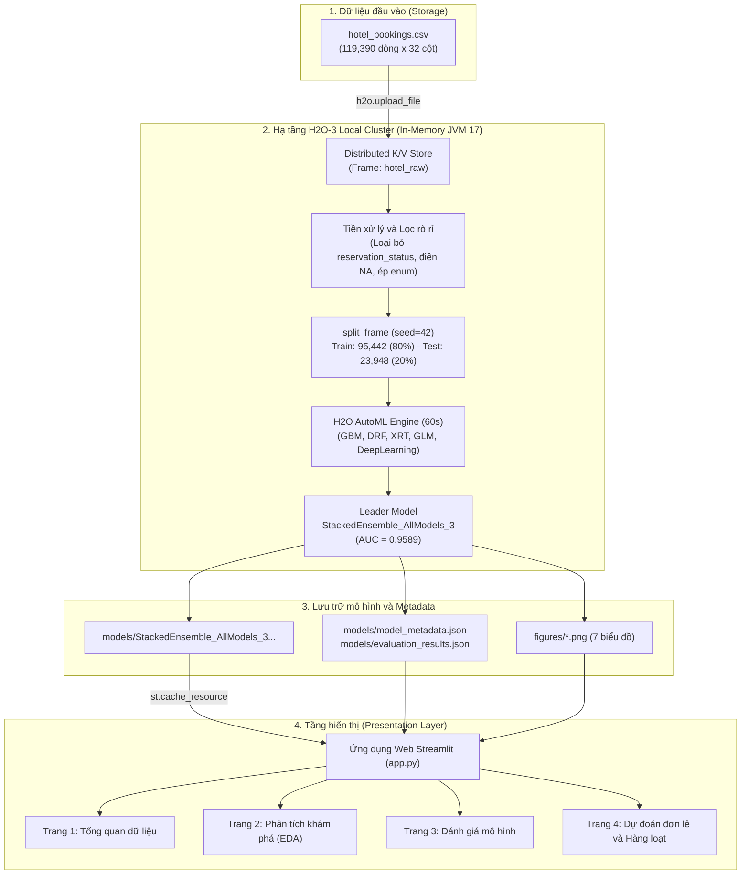

# BÁO CÁO VÀ HƯỚNG DẪN DỰ ÁN BIG DATA

## Đề tài: H2O – Nền tảng Machine Learning phân tán trên dữ liệu lớn
### Bài toán thực nghiệm: Phân tích và dự đoán khả năng khách hàng hủy đặt phòng khách sạn bằng H2O AutoML

---

## 1. Mục tiêu dự án

Dự án này là phần thực nghiệm mở rộng nhằm minh chứng cho báo cáo lý thuyết về **"Nền tảng H2O-3 trong xử lý và huấn luyện Machine Learning phân tán trên dữ liệu lớn"**, tập trung vào các mục tiêu cụ thể:
1. **Xử lý dữ liệu lớn trong bộ nhớ (In-Memory Computing):** Nạp và thao tác trực tiếp trên cấu trúc phân tán `H2OFrame` của cụm H2O-3 mà không phụ thuộc vào Pandas trên một máy đơn lẻ.
2. **Khám phá và phân tích hành vi đặt phòng (EDA):** Nhận diện các yếu tố ảnh hưởng mạnh nhất đến quyết định hủy phòng của khách như `lead_time`, `deposit_type`, `market_segment`, `booking_changes` trên 119,390 bản ghi.
3. **Phòng chống rò rỉ dữ liệu (Data Leakage Prevention):** Loại bỏ triệt để các đặc trưng mang tính hồi tố sau khi sự kiện đã xảy ra (`reservation_status`, `reservation_status_date`) để bảo đảm mô hình có giá trị thực tiễn.
4. **Tự động hóa học máy (H2O AutoML):** Khảo sát song song 22 mô hình thuộc các họ thuật toán GBM, Random Forest, GLM và Deep Learning, từ đó tự động xây dựng mô hình xếp tầng tối ưu **Stacked Ensemble**.
5. **Đánh giá khách quan trên tập Test độc lập:** Sử dụng 23,948 dòng kiểm tra chưa từng thấy để đối chiếu độ tin cậy của ROC-AUC, Accuracy, Precision, Recall và F1-Score.
6. **Xây dựng ứng dụng Web tương tác (Streamlit):** Cung cấp giao diện trực quan hỗ trợ cả dự đoán đơn lẻ cho nhân viên lễ tân và dự đoán hàng loạt từ file CSV cho ban quản lý khách sạn.

---

## 2. Kiến trúc hệ thống



---

## 3. Cấu trúc thư mục dự án

```text
hotel_cancellation_h2o/
│
├── data/
│   ├── hotel_bookings.csv         # Dữ liệu gốc Kaggle (119,390 dòng x 32 cột)
│   ├── train_clean.csv            # Tập huấn luyện sạch (95,442 dòng - 79.94%)
│   ├── test_clean.csv             # Tập kiểm tra độc lập (23,948 dòng - 20.06%)
│   └── sample_batch_test.csv      # File mẫu 50 dòng phục vụ demo dự đoán hàng loạt
│
├── figures/                       # 7 biểu đồ phân tích & đánh giá (200 DPI)
│   ├── 01_cancellation_distribution.png
│   ├── 02_lead_time_distribution.png
│   ├── 03_cancellation_by_deposit_type.png
│   ├── 04_cancellation_by_market_segment.png
│   ├── 05_missing_values.png
│   ├── 06_roc_curve.png
│   └── 07_confusion_matrix.png
│
├── models/
│   ├── StackedEnsemble_AllModels_3_AutoML_1_20261027_35724  # Model nhị phân H2O
│   ├── model_metadata.json        # Metadata thông số & Leaderboard 22 mô hình
│   └── evaluation_results.json    # Bảng chỉ số đánh giá chi tiết trên tập test
│
├── src/
│   ├── eda.py                     # Khám phá dữ liệu và xuất đồ thị phân tích
│   ├── prepare_data.py            # Tiền xử lý, lọc rò rỉ dữ liệu, chia 80/20
│   ├── train_automl.py            # Huấn luyện mô hình bằng H2O AutoML (60s)
│   ├── evaluate_model.py          # Đánh giá mô hình Leader trên tập test độc lập
│   ├── test_end_to_end.py         # Bộ kiểm thử tích hợp 11 bài test tự động
│   └── features_config.json       # Danh sách 29 features và cấu hình chuẩn
│
├── app.py                         # Ứng dụng Web UI hoàn chỉnh bằng Streamlit
├── requirements.txt               # Danh mục thư viện phụ thuộc
└── README.md                      # Tài liệu hướng dẫn toàn diện
```

---

## 4. Yêu cầu môi trường & Cài đặt

### Yêu cầu môi trường:
* **Hệ điều hành:** Windows 10 hoặc Windows 11 (64-bit).
* **Python:** Phiên bản 3.10 đến 3.13 (Khuyến nghị Python 3.11 hoặc 3.13 64-bit).
* **Java Runtime:** Java JDK 8, 11 hoặc 17 (Khuyến nghị **OpenJDK 17 LTS Temurin**).
  * Kiểm tra Java bằng lệnh: `java -version`

### Cài đặt thư viện:
Mở PowerShell hoặc Command Prompt tại thư mục dự án và chạy:

```powershell
pip install -r requirements.txt
```

*Nội dung file `requirements.txt`:*
```text
h2o>=3.46.0
pandas>=2.0.0
numpy>=1.24.0
scikit-learn>=1.3.0
matplotlib>=3.7.0
streamlit>=1.30.0
```

---

## 5. Hướng dẫn chạy các bước của dự án

### Bước 1: Khám phá dữ liệu (EDA)
```powershell
python src/eda.py
```
*Tác vụ:* Nạp dữ liệu vào H2OFrame, phân tích phân bố biến `is_canceled`, kiểm tra giá trị thiếu và xuất 5 biểu đồ vào thư mục `figures/`.

### Bước 2: Chuẩn bị dữ liệu (Data Preparation)
```powershell
python src/prepare_data.py
```
*Tác vụ:* 
* Loại bỏ triệt để 2 cột rò rỉ: `reservation_status` và `reservation_status_date`.
* Xử lý giá trị thiếu: Điền 0 cho `children` (4 giá trị), điền 0 cho `agent` (16,340 giá trị), tạo đặc trưng nhị phân `has_company` cho `company`.
* Ép kiểu danh mục (`asfactor()`) cho 12 biến phân loại.
* Phân chia tập dữ liệu 80% Train (95,442 dòng) và 20% Test (23,948 dòng) với `seed=42`.

### Bước 3: Huấn luyện H2O AutoML (Model Training)
```powershell
python src/train_automl.py
```
*Tác vụ:* Chạy H2O AutoML trên tập Train trong 60 giây (`sort_metric="AUC"`), đánh giá nội bộ qua 5-Fold Cross-Validation, xuất bảng Leaderboard và lưu mô hình tốt nhất vào `models/`.

### Bước 4: Đánh giá mô hình độc lập (Model Evaluation)
```powershell
python src/evaluate_model.py
```
*Tác vụ:* Nạp mô hình Leader từ đĩa, đánh giá trên 23,948 dòng tập test độc lập, tính toán đầy đủ các chỉ số AUC, Accuracy, Precision, Recall, F1-Score và vẽ ROC curve, Confusion Matrix.

### Bước 5: Kiểm thử tự động toàn diện hệ thống (End-to-End Audit)
```powershell
python src/test_end_to_end.py
```
*Tác vụ:* Thực thi 11 bài kiểm thử tự động xác nhận tính toàn vẹn file, kiểm tra chống rò rỉ dữ liệu, khớp danh sách đặc trưng, độ ổn định khi gặp dữ liệu biên và biên dịch ứng dụng.

---

## 6. Hướng dẫn khởi chạy và sử dụng Giao diện Web Streamlit

### Khởi chạy ứng dụng:
Từ cửa sổ PowerShell tại thư mục dự án, gõ:

```powershell
streamlit run app.py
```

Trình duyệt web sẽ tự động mở tại địa chỉ: `http://localhost:8501`.

### Hướng dẫn sử dụng 4 trang chức năng:

1. **Trang 1 - Tổng quan dữ liệu:** Xem các chỉ số KPI tổng thể của tập dữ liệu, phân bố đơn hủy vs không hủy, tỷ lệ khuyết dữ liệu và duyệt bảng dữ liệu mẫu.
2. **Trang 2 - Phân tích khám phá (EDA):** Xem chi tiết 3 phát hiện quan trọng về hành vi đặt phòng (Lead time, Nghịch lý Non Refund, Phân khúc thị trường), cùng bộ lọc tương tác theo loại khách sạn và phân khúc.
3. **Trang 3 - Đánh giá mô hình:** Xem hiệu năng mô hình trên tập Test độc lập, xem đường cong ROC Curve, Ma trận nhầm lẫn Confusion Matrix và duyệt toàn bộ 22 mô hình trên bảng xếp hạng AutoML Leaderboard.
4. **Trang 4 - Dự đoán đặt phòng:**
   * **Dự đoán đơn lẻ (Tab 1):** Điền các thông tin của khách hàng vào 3 cột (Khách sạn & thời gian, Khách hàng & phòng, Kênh đặt & cọc), kéo thanh trượt tùy chỉnh ngưỡng phân loại (mặc định 0.45) và nhấn **"THỰC HIỆN DỰ ĐOÁN XÁC SUẤT HỦY"**. Hệ thống sẽ hiển thị hộp cảnh báo màu đỏ hoặc xanh kèm phân tích % xác suất và gợi ý hành động cụ thể cho khách sạn.
   * **Dự đoán hàng loạt (Tab 2):** Bấm nút **"Tải file mẫu kiểm tra"** để nhận file `sample_batch_test.csv` (50 dòng), sau đó tải file này lên form để hệ thống tự động gắn xác suất và nhãn dự đoán cho toàn bộ danh sách, hỗ trợ xuất file kết quả `predictions.csv`.

---

## 7. Các chỉ số đánh giá thực tế (Tập Test độc lập 23,948 dòng)

Toàn bộ các chỉ số được ghi nhận trực tiếp từ lần chạy thực tế của mô hình `StackedEnsemble_AllModels_3`:

| Chỉ số đánh giá | Giá trị thực nghiệm | Tỷ lệ % | Đánh giá | Ý nghĩa nghiệp vụ |
| :--- | :---: | :---: | :---: | :--- |
| **ROC-AUC** | **`0.9589`** | **95.89%** | Xuất sắc | Khả năng phân biệt hai nhóm khách hủy và không hủy vượt trội |
| **Accuracy** | **`0.8904`** | **89.04%** | Tốt | Dự đoán chính xác 21,324 trên tổng số 23,948 lượt đặt phòng |
| **Precision** | **`0.8532`** | **85.32%** | Tốt | Khi mô hình báo "sẽ hủy", có 85.32% khả năng là hủy thật |
| **Recall** | **`0.8525`** | **85.25%** | Tốt | Bắt trúng 85.25% các trường hợp thực tế sẽ hủy phòng |
| **F1-Score** | **`0.8528`** | **85.28%** | Rất cao | Độ cân bằng tối ưu giữa việc tránh bỏ sót và tránh báo động giả |
| **Specificity** | **`0.9130`** | **91.30%** | Xuất sắc | Nhận diện chính xác 91.30% khách hàng sẽ check-in thành công |
| **PR-AUC** | **`0.9413`** | **94.13%** | Rất cao | Diện tích dưới đường cong Precision-Recall |
| **Logloss** | **`0.2456`** | — | Thấp | Phân phối xác suất dự đoán có độ tự tin cao |

#### Ma trận nhầm lẫn chi tiết (Threshold = 0.4469):
* **True Negative (TN):** `13,720` phòng (Đoán đúng Không hủy).
* **True Positive (TP):** `7,604` phòng (Đoán trúng Đã hủy).
* **False Positive (FP):** `1,308` phòng (Báo động nhầm).
* **False Negative (FN):** `1,316` phòng (Bỏ sót rủi ro).

---

## 8. Những giới hạn của mô hình và Hướng phát triển

1. **Thời gian chạy AutoML ban đầu:** Thử nghiệm với `max_runtime_secs=60` giúp pipeline chạy nhanh, nhưng các mạng nơ-ron sâu (`DeepLearning`) chưa kịp hội tụ hoàn toàn. Trong môi trường doanh nghiệp thực tế, có thể nâng lên 10–30 phút để tối ưu hóa triệt để.
2. **Thuật toán XGBoost:** Trên môi trường Windows cục bộ thiếu thư viện C++ OpenMP runtime nên XGBoost tự động được bỏ qua. Có thể bổ sung thư viện để bổ sung các cấu hình XGBoost vào Leaderboard.
3. **Hiện tượng thay đổi phân phối theo thời gian (Concept Drift):** Dữ liệu gốc thu thập từ 2015 đến 2017. Hành vi của khách du lịch hiện đại có thể có sự biến động. Hệ thống cần được thiết lập cơ chế tái huấn luyện định kỳ (Retraining Pipeline) trên cụm H2O để cập nhật tri thức mới.
